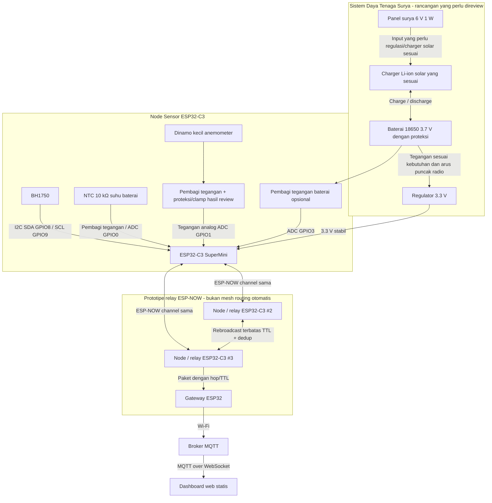

# Diagram Sistem Node Sensor Surya

## Peringatan rancangan daya

Diagram awal mengusulkan panel 6 V → dioda 1N5819 → TP4056 → sel Li-ion → HT7333. Jangan rakit susunan tersebut tanpa tinjauan: TP4056 standar ditujukan untuk sumber input yang sesuai batas tegangan dan relatif stabil; panel surya 6 V plus dioda bukan pengatur tegangan atau pengendali titik daya. Tegangan panel dapat melampaui rating input yang aman dan karakteristik panel berubah terhadap cahaya. Gunakan charger solar yang memang sesuai, verifikasi batas input/current limit/kimia sel dan proteksi, lalu tinjau regulator untuk arus puncak ESP32. Semua perakitan baterai dilakukan di bawah supervisi yang sesuai.

## Sinyal anemometer

Firmware menyediakan masukan ADC dan menerbitkan `wind_input_v` saja. Nilai tersebut bukan kecepatan angin. Dibutuhkan datasheet/karakterisasi dinamo, validasi divider-zener/penjepit, dan kalibrasi terhadap alat rujukan untuk menghasilkan satuan m/s.
